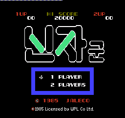

# 닌자군 - 마성의 모험 한글 패치 v1.0

패미컴/NES 일본판 **Ninja-kun - Majou no Bouken**의 타이틀 로고를 `닌자군`으로 번역한 팬 패치입니다. 인원 메뉴·HUD·시작 안내·게임 오버·보너스 등 영문은 원문을 유지합니다.

**[v1.0 패치 받기](https://github.com/akuma815/nes-ninja-kun-majou-no-bouken-kr-patch/releases/tag/v1.0)** · [ZIP 직접 받기](https://github.com/akuma815/nes-ninja-kun-majou-no-bouken-kr-patch/releases/download/v1.0/Ninja_kun_Majou_no_Bouken_KR_v1.0.zip) · [한글 패치 아카이브](https://akuma815.github.io/)



위 이미지는 배포 결과 ROM과 동일한 SHA-256에서 촬영한 Mesen 2.1.1 실제 타이틀 화면입니다. 자르거나 보정하지 않았습니다.

## 적용 방법

1. 릴리즈의 `Ninja_kun_Majou_no_Bouken_KR_v1.0.zip`을 내려받아 전체 압축을 풉니다. GitHub의 Source code 압축파일은 패치 배포본과 다릅니다.
2. 지원 일본판 원본 `.nes`를 `apply.cmd` 위로 끌어 놓습니다.
3. 같은 폴더에 생성되는 `Ninja_kun_Majou_no_Bouken_KR_v1.0.nes`를 새로 부팅합니다.

Windows PowerShell 5.1/.NET을 사용하며 원본·기존 출력 파일을 덮어쓰지 않습니다. 다른 운영체제에서는 BPS 지원 패처를 사용할 수 있습니다.

## 지원 원본과 결과

| 항목 | 크기 | SHA-256 |
|---|---:|---|
| 일본판 원본, iNES 헤더 포함 | 24,592바이트 | `7d4e1f61f8f7464d73a35c5118f59227dd7d7ddd6c3c2a62e42f5a0ac9477978` |
| v1.0 결과 | 49,168바이트 | `325109b789525c781cb72e78392768df8625fd55c04f78f329ece540993cf51d` |

그래픽 공간 확보를 위해 **매퍼3(CNROM), PRG32KiB/CHR16KiB**로 확장했습니다. 원래 NROM 카트리지 회로와 다르며 CNROM 지원 에뮬레이터에서 사용합니다. 원본 ROM용 세이브스테이트를 그대로 불러오지 마세요.

## 확인 범위

- 원본 식별·Expected Write·512타일 왕복·보호 영역·최종 그림·BPS 적용 결과를 검사했습니다.
- Mesen 2.1.1에서 부팅·1인 시작·짧은 입력·리셋 복귀를 확인했습니다. 타이틀 6장은 로고 밖 차이 0, 비타이틀 4장은 전체 픽셀 차이 0입니다.
- 사용자 실제 플레이에서 타이틀 외 일본어를 발견하지 못했다는 보고를 받았습니다. 에이전트의 원본 그래픽/화면 조사에서도 추가 일문은 확인되지 않았습니다. 보너스 조사는 RAM 제어 실험을 포함하며 실제 획득·완주와 구분합니다.
- 에이전트 전체 완주·모든 후반 씬·실기·다른 에뮬레이터·오디오 청취는 미수행입니다. 숨은 모든 메시지를 전수 배제한 완전 번역을 뜻하지 않습니다.

## 소스 빌드

Python 3.10 이상과 Pillow를 사용합니다. 원본 ROM은 포함하지 않으며 지원 원본을 직접 마련해야 합니다.

```powershell
python -m pip install -r requirements.txt
powershell -NoProfile -ExecutionPolicy Bypass -File scripts/build.ps1 -SourceRom '원본 경로.nes'
```

기본 경로를 쓰려면 `original/rom/Ninja-kun - Majou no Bouken (Japan).nes`에 원본을 둡니다. 출력은 `build/title_kr_release_100/`, 공개용 BPS는 `patches/`에 생성됩니다. 개발용 IPS는 로컬 진단 산출물이며 공개 배포에는 포함하지 않습니다. 원본 ROM·BIOS·완성 ROM·메모리 덤프·에뮬레이터는 이 저장소에 없습니다.
